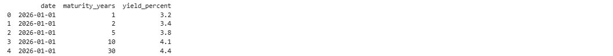
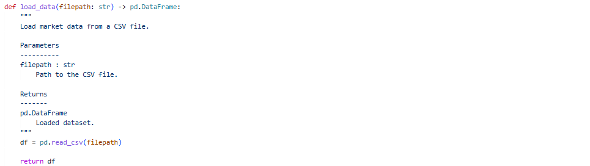
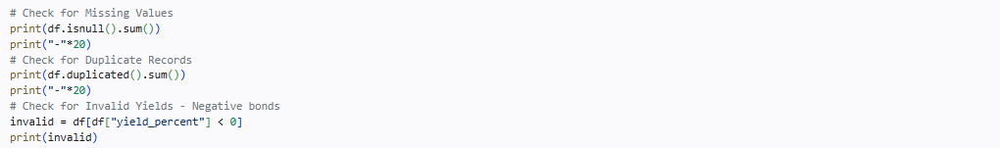
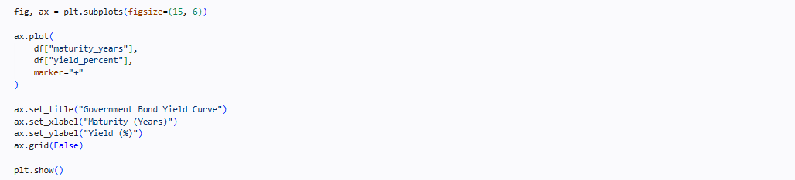
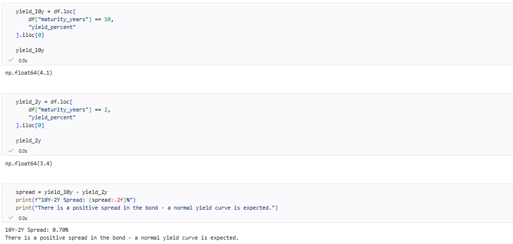
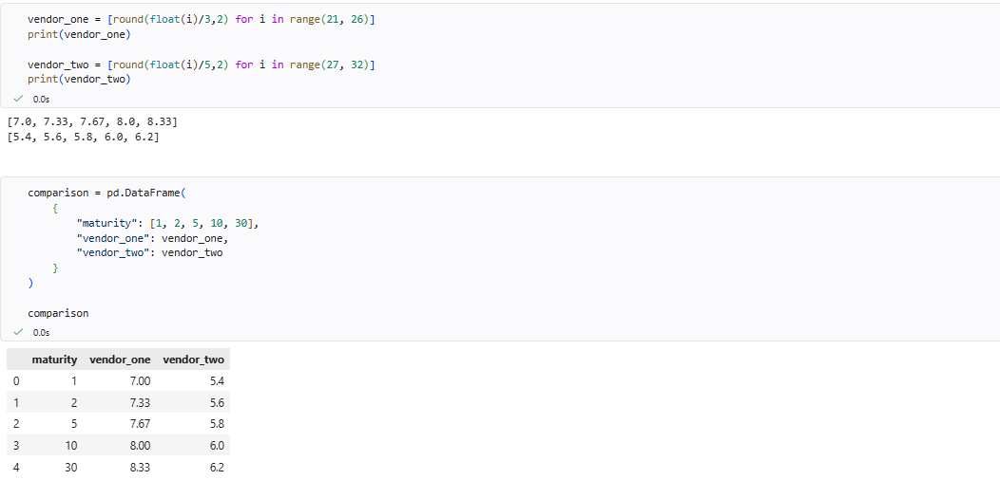
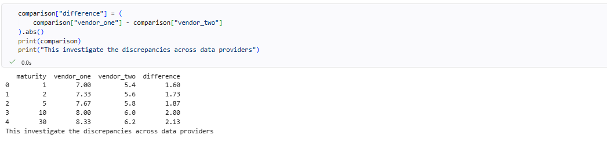
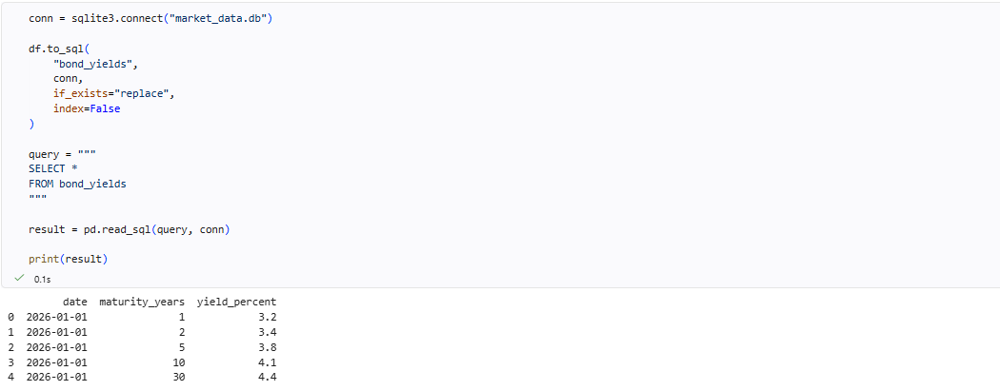

## **Financial Market Analytics and Yield Curve Analysis System**

### **Overview**

This project demonstrates an end-to-end financial data analytics workflow for processing, validating, and analyzing fixed-income market data.

The platform simulates the type of market data pipelines used by quantitative research and investment firms to support financial analysis, yield curve construction, market monitoring, and data quality assessment.

The project showcases core skills relevant to financial data engineering and quantitative research, including:

- Financial data ingestion
- Data validation and quality assessment
- Yield curve construction
- Fixed-income analytics
- Market data consistency checks
- SQL integration
- Automated analytical workflows
- Python-based data processing

### **Business Problem**

Quantitative researchers, portfolio managers, and traders rely on clean and reliable financial datasets to evaluate market conditions and support investment decisions.

Financial data sourced from multiple providers often contains:

- Missing values
- Data inconsistencies
- Pricing discrepancies
- Reference data mismatches

This project demonstrates a simplified workflow for validating and analyzing government bond market data before it can be used in research environments.

### **Project Architecture**

### **Dataset**

The project uses a simulated bond yield dataset and the purpose is to demonstrate end-to-end workflow for a financial market analytics.

Although very simple however the dataset represents a typical yield curve used in fixed-income financial analytics.

### **Features**
1. *Data Ingestion*: Import market data from CSV files.

2. *Data Validation*

Automatically checks for:
- Missing Values
- Duplicate Records
- Invalid Yields
- Data Quality Issues

3. *Yield Curve Construction*
 Visualize the term structure of Interest rates.

 

4. *Yield Spread Analytics*: This calculate the common fixed-income metrics and measures `Yield Curve steepness`, `Inversion Risk`, `Macro-economic expectations`.

5. *Vendor Consistency Checks*

Compare market data received from different providers and identify the following: `Pricing inconsistencies`, `Vendor discrepancies` and `Data quality issues`.

6. *SQL Integration*: Stored validated market data in a relational database.

### **Analytics Delivered**

The system generates:

- Yield curves
- Term structure analytics
- Yield spread calculations
- Vendor comparison reports
- Data quality reports

### **Technology Stack**

**Programming**
- Python

**Data Analysis**
- Pandas
- NumPy

**Visualization**
- Matplotlib

**Database**
- SQLite

**Development Environment**
- VSCode
- Python files

### **Skills Demonstrated**

This project demonstrates competencies commonly required in quantitative research and financial data roles:

- Financial Data Analysis
- Fixed Income Analytics
- Yield Curve Analysis
- Market Data Processing
- Data Validation
- Data Quality Controls
- Python Programming
- Pandas & NumPy
- SQL
- ETL Pipelines
- Data Engineering
- Quantitative Analytics
- Research Data Support
- Workflow Automation

### **Future Improvements**

The project could be replicated with a real time and live data for potential enhancements, data from the following sources can be used to deliver scalable solutions and systems that align with the business objective:

- Real Treasury market data ingestion
- Bloomberg API integration
- Refinitiv Data Platform integration
- Interest rate forecasting models
- Yield curve interpolation methods
- Duration and convexity calculations
- Bond pricing analytics
- Dashboard development using Streamlit
- Automated daily market reports

### **Author**

`Olanrewaju Adegoke (MSc, BTech, FMVA, ND)`

`Data Scientist | Financial Data Scientist | AI&ML Engineer`

